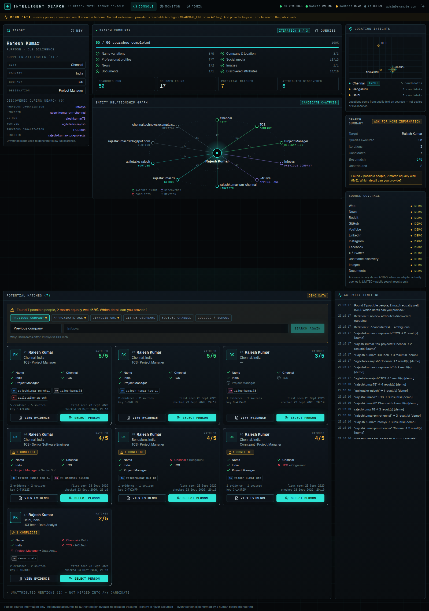
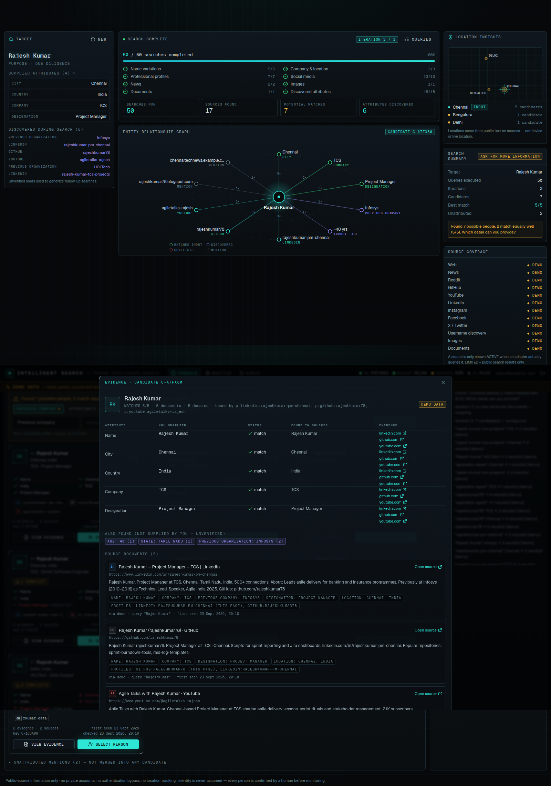
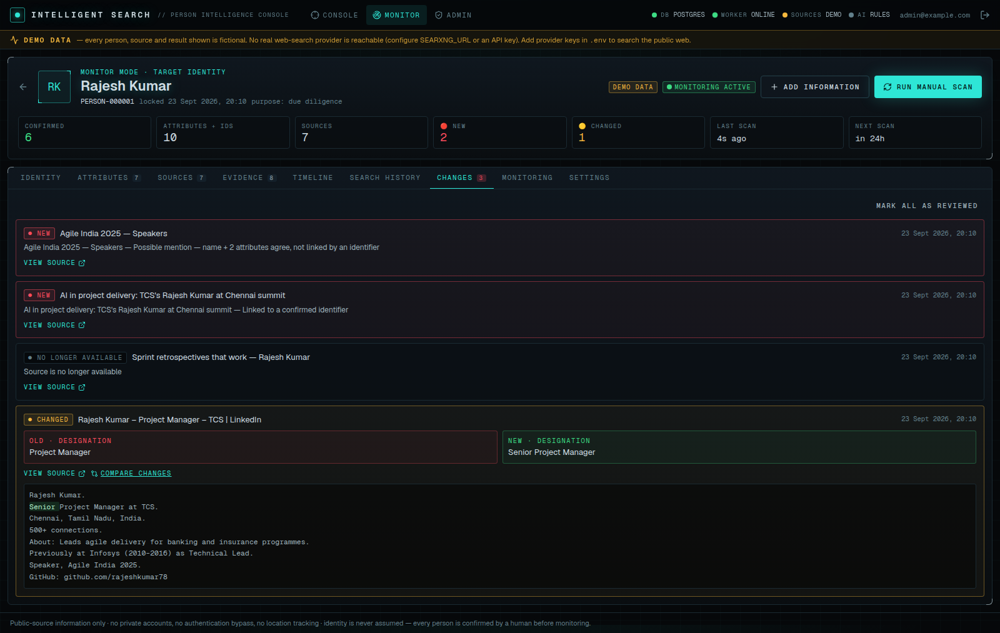

# IntelligentSearch

**Public-information person discovery, identity resolution and monitoring — with a human in the loop.**

```
DISCOVER → MATCH → SHOW EVIDENCE → ASK USER → CONFIRM → LOCK → MONITOR
```

IntelligentSearch turns a few known facts about a person (name, city, company, job title, usernames…) into a prioritised set of search hypotheses, runs them across pluggable public sources, groups the results into **candidate persons**, and explains attribute-by-attribute — with source links — why each candidate does or does not match. When ambiguity remains it **asks you for another detail** instead of guessing. Only after you explicitly confirm a candidate is the identity **locked** and **monitored** for new and changed public information.

> The system never decides “this is definitely the person”. A human confirms every identity.



| | |
|---|---|
|  |  |

---

## Contents

1. [Prerequisites](#1-prerequisites)
2. [Installation](#2-installation)
3. [Configuration (.env)](#3-configuration)
4. [Start development](#4-start-development)
5. [Demo mode](#5-demo-mode)
6. [Configure providers](#6-configure-providers)
7. [How monitoring works](#7-how-monitoring-works)
8. [Deploy](#8-deploy)
9. [Testing](#9-testing) · [Project layout](#project-layout) · [Documentation](#documentation) · [Responsible use](#responsible-use)

---

## 1. Prerequisites

| Need | Version | Notes |
|---|---|---|
| Node.js | ≥ 20.9 (22 LTS recommended) | Required |
| npm | ≥ 10 | Required |
| PostgreSQL | 14+ | **Optional** for development — an embedded Postgres (PGlite) is used automatically when `DATABASE_URL` is empty |
| Docker + Compose | any recent | Optional — SearXNG, Postgres, Maigret sidecar, changedetection.io |
| Python | 3.10+ | Optional — only to run the Maigret sidecar without Docker |

## 2. Installation

```bash
git clone https://github.com/sairamsnexus-gif/IntelligentSearch.git
cd IntelligentSearch
npm install
```

## 3. Configuration

1. Copy `.env.example` to `.env`
   ```bash
   cp .env.example .env
   ```
2. Enter the API keys you have (all optional — see [API configuration](docs/API_CONFIGURATION.md)).
3. Start the application (`npm run dev`).

`.env` is git-ignored (`.env`, `.env.*`, except `.env.example`). Keys are read **server-side only** and never sent to the browser. With no keys at all the app runs in **demo mode**.

Key variables:

| Variable | Purpose | Default |
|---|---|---|
| `GEMINI_API_KEY` | AI extraction of attributes from free text (optional; rule-based extraction always runs) | – |
| `TAVILY_API_KEY`, `BRAVE_SEARCH_API_KEY`, `SERPER_API_KEY` | Optional web-search providers | – |
| `SEARXNG_URL` | Self-hosted metasearch (free) | `http://localhost:8080` |
| `SEARCH_API_URL`, `SCRAPER_API_URL` | Optional DeepSearch services | – |
| `REDDIT_CLIENT_ID/SECRET` | Reddit official API | – |
| `GITHUB_TOKEN`, `YOUTUBE_API_KEY` | Higher GitHub rate limit / YouTube channel search | – |
| `MAIGRET_SERVICE_URL` | Python username-discovery sidecar | – |
| `CHANGEDETECTION_URL/API_KEY` | Delegate page watching to changedetection.io | – |
| `DATABASE_URL` | PostgreSQL; empty = embedded PGlite in `./.data/pglite` | – |
| `MONITOR_INTERVAL_HOURS` | Default scan interval | `24` |
| `MAX_DISCOVERY_ITERATIONS` | Iterative discovery rounds | `3` |
| `DEMO_MODE` | `auto` / `true` / `false` | `auto` |
| `AUTH_SECRET` | Session signing key (`openssl rand -hex 32`) | generated in dev |
| `RUN_WORKER_IN_PROCESS` | Run the job worker inside the web server | `true` |

## 4. Start development

```bash
npm run dev          # http://localhost:3000
```

- First visit opens **/setup**: create the first operator account (becomes admin).
- Migrations run automatically on first database access.
- Background jobs (searches, baselines, monitoring scans, scheduler) run in-process in dev.

Useful scripts:

| Script | Does |
|---|---|
| `npm run dev` | Next.js dev server + in-process worker |
| `npm run build && npm start` | Production build / serve |
| `npm run worker` | Standalone worker (production; needs `DATABASE_URL`) |
| `npm test` | Unit + integration tests (Vitest, embedded Postgres) |
| `npm run lint` / `npm run typecheck` | ESLint / TypeScript strict |
| `npm run e2e` | Browser walkthrough of all acceptance criteria (needs a running app) |
| `npm run db:generate` | Generate a new Drizzle migration after editing the schema |

## 5. Demo mode

Demo mode lets you exercise the full workflow before entering any key.

- `DEMO_MODE=auto` (default): demo is used when **no real web-search provider** (SearXNG, Brave, Serper, Tavily, DeepSearch) is reachable.
- `DEMO_MODE=true` forces it; `DEMO_MODE=false` disables it.
- Demo data is **entirely fictional**, labelled **DEMO DATA** everywhere, and never mixed with real results. “Open source” links render the fake page locally at `/demo-source` instead of linking to real sites.

Walkthrough:

1. Search **Rajesh Kumar** → *Add more details* → Chennai · India · TCS · Project Manager → **SEARCH PERSON**.
2. Watch ~50 generated queries run over 3 iterations (the second iteration is driven by discovered attributes such as *Infosys* and *rajeshkumar78*).
3. Seven fictional candidates appear; two match **5/5** → the system asks for another detail (it suggests *Previous company* because the two differ: Infosys vs HCLTech).
4. Enter **Infosys** → *Search again* → one candidate leads **6/6**.
5. **SELECT PERSON** → confirm → **LOCK PERSON & START MONITORING**.
6. **RUN MANUAL SCAN** → 🔴 a new article, 🟡 the LinkedIn title changed (*Project Manager → Senior Project Manager*, with diff), ⚫ a blog post disappeared.
7. **ADD INFORMATION** → Instagram `rajeshkumar78` → *Verify* (corroborated) → added to the **same** person and used by the next scan’s search plan.

## 6. Configure providers

Everything is an adapter behind one interface (`src/lib/adapters`). Free/local first:

| Priority | Provider | Key needed | Enable by |
|---|---|---|---|
| 1 | **SearXNG** (local) | no | `docker compose up -d searxng` (JSON output pre-enabled in `deploy/searxng/settings.yml`) |
| 2 | Google News RSS | no | always on |
| 3 | GitHub public API | no (token optional) | always on |
| 4 | FindME username rules (18 platforms) | no | always on |
| 5 | Maigret sidecar (thousands of sites) | no | `docker compose up -d osint-python`, set `MAIGRET_SERVICE_URL=http://localhost:8090` |
| 6 | Reddit official API | client id/secret | Reddit “script” app |
| 7 | YouTube Data API | key | Google Cloud console |
| 8 | Brave / Serper / Tavily | key | provider dashboards |
| – | DeepSearch services | URL | run upstream `search.py` / `scraper.py` |
| – | changedetection.io | URL + key | `docker compose --profile changedetection up -d` |

Admins can enable/disable providers and run health checks under **Admin → Providers & health**. The console’s **SOURCE COVERAGE** panel only shows a source as ACTIVE when an adapter actually queries it; LinkedIn / Instagram / Facebook / X are always **LIMITED** (public search results only — no login, no scraping of logged-in pages).

## 7. How monitoring works

After a person is locked:

1. **Baseline** — every known source is snapshotted (normalised text + SHA-256).
2. **Scheduled scans** every `MONITOR_INTERVAL_HOURS` (per-person override in the UI), plus **manual scans**.
3. Each scan (a) re-checks known URLs via the best legitimate method (GitHub/Reddit API, robots-aware direct fetch, changedetection.io, or search results for login-walled platforms) and (b) runs a small search plan generated from the **confirmed identity** — including identifiers you add later.
4. Results are classified **NEW / CHANGED / UNCHANGED (EXISTING) / NO LONGER AVAILABLE**; changes store a word-level diff and attribute-level OLD → NEW, create alerts and timeline events, and link to evidence.
5. Caching (6 h per query/provider), query de-duplication, content hashes, per-provider rate limits and exponential retries keep cost low.

Details: [docs/MONITORING.md](docs/MONITORING.md).

## 8. Deploy

- **Web app** → Vercel (or any Node host) with a managed Postgres (Supabase/Neon/RDS). Set `RUN_WORKER_IN_PROCESS=false`.
- **Worker** → a long-running container/VM (`npm run worker`) — Vercel functions are not a scheduler.
- **Everything in containers** → `docker compose --profile app up -d --build`.

See [docs/DEPLOYMENT.md](docs/DEPLOYMENT.md).

## 9. Testing

```bash
npm test                 # 78 unit + integration tests (planner, resolution, change detection, scheduler, security, adapters, full pipeline)
npm run build && PGLITE_DATA_DIR=./.data/e2e npx next start -p 3100 &
BASE_URL=http://localhost:3100 npm run e2e   # 32 acceptance checks in a real browser
```

The integration suite and the E2E walkthrough have been run against both embedded PGlite and PostgreSQL 16 (with the standalone worker).

## Project layout

```
src/
  app/                 Next.js App Router (pages + API routes)
  components/          console, person (monitor mode), admin, ui (shadcn-style primitives)
  lib/
    core/              pure domain logic: planner, extraction, resolution, change detection, scheduling
    adapters/          SearXNG, Brave, Serper, Tavily, DeepSearch, GitHub, Reddit, YouTube, News RSS,
                       FindME, Maigret, direct web, changedetection.io, demo
    services/          discovery sessions, person lock & enrichment, monitoring, job queue
    db/                Drizzle schema + client (Postgres or PGlite)
    security/          SSRF-safe fetch, robots.txt, rate limiting, redacting logger
    auth/              scrypt passwords, HMAC session cookies, guards
services/osint-python/ Maigret FastAPI sidecar
drizzle/               SQL migrations
tests/                 Vitest unit + integration
scripts/               worker, e2e walkthrough
```

## Documentation

- [Architecture](docs/ARCHITECTURE.md)
- [Search engine & planner](docs/SEARCH_ENGINE.md)
- [Identity resolution](docs/IDENTITY_RESOLUTION.md)
- [Monitoring](docs/MONITORING.md)
- [Open-source components](docs/OPEN_SOURCE_COMPONENTS.md)
- [API configuration](docs/API_CONFIGURATION.md)
- [Security](docs/SECURITY.md)
- [Deployment](docs/DEPLOYMENT.md)

## Responsible use

IntelligentSearch is for lawful purposes using **publicly available information only**. It does not bypass authentication or CAPTCHAs, access private accounts, posts or messages, ask for social-media passwords, perform phone or device tracking, or look up carrier/subscriber data. Every search records a stated purpose and every lock/scan/change is audit-logged. Respect local privacy law (e.g. GDPR, India’s DPDP Act) and the terms of every source you enable.
