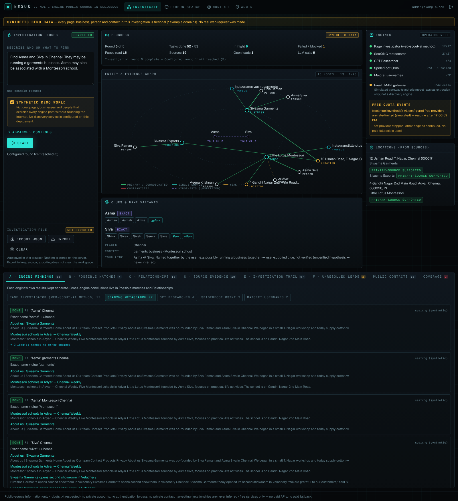
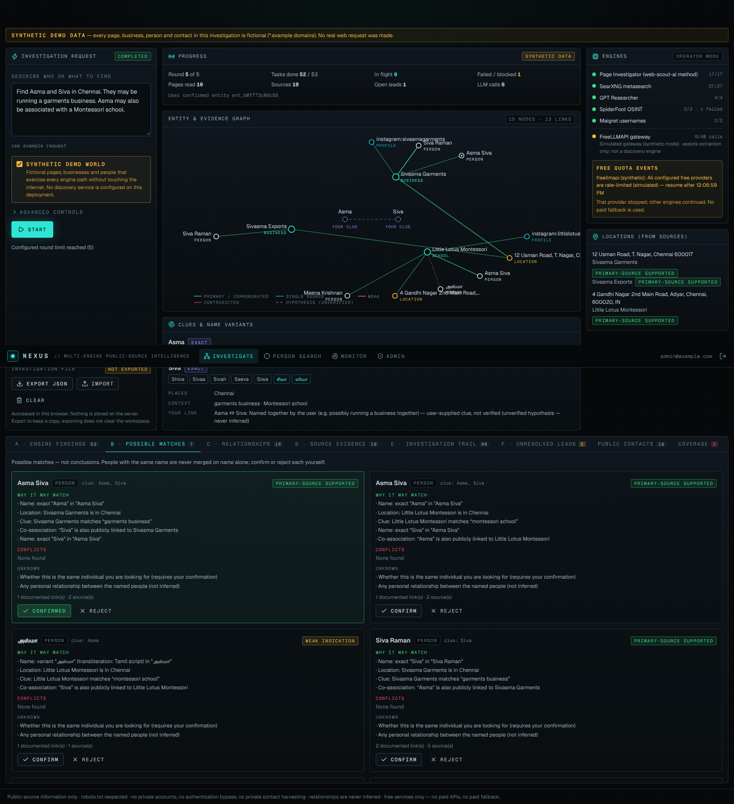
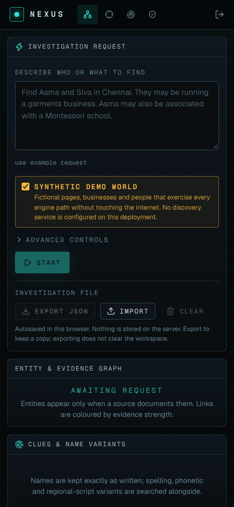

# NEXUS

**Multi-engine public-source intelligence. Evidence first, human-confirmed, zero-cost.**

You describe who or what you are looking for in plain language, for example:

> *Find Asma and Siva in Chennai. They may be running a garments business. Asma may also be associated with a Montessori school.*

NEXUS keeps the names exactly as written and adds spelling, phonetic and regional-script variants (Siva → Shiva, Sivaa, Seeva, **சிவா**; Asma → Asmah, **அஸ்மா**). It then runs five independent discovery engines. Each engine's leads are handed to the others over several rounds: SearXNG finds an *About* page, the Page Investigator reads it, SpiderFoot reports an affiliated domain, the Page Investigator opens that domain, and so on. Every fact is recorded with the exact source passage and a verification state. Results are presented as **possible matches with matches, conflicts and unknowns** for you to confirm or reject. NEXUS never decides identity on its own.



| | |
|---|---|
|  |  |

*(Screenshots use the clearly labelled **synthetic demo world**: fictional `*.example` sites and people.)*

---

## Engines

| Engine | Role | Integration | Status |
|---|---|---|---|
| **Page Investigator** (web-scout-ai method) | Reads pages and follows about/contact/team links. Extracts organisations, documented roles, public contacts, addresses and founding years with evidence passages | Native (web-scout-ai MIT, reference only) | **Implemented**, operator + hosted |
| **SearXNG** | Metasearch for names, variants, scripts and discovered organisations | Separate service (AGPL-3.0, unmodified) | **Implemented**; needs an instance |
| **GPT Researcher** | Independent research plan and narrative; its cited sources become leads | Python sidecar (Apache-2.0) | **Implemented, local-only** |
| **SpiderFoot** | Domain OSINT (affiliated hosts, company names, linked emails and socials) | Separate service + REST adapter, free-module allowlist (MIT) | **Implemented, local-only** |
| **Maigret** | Whether a username exists on public sites (existence only) | Python sidecar (MIT) | **Implemented, local-only** |
| **FreeLLMAPI** (gateway, not a discovery engine) | Quote-verified extraction assistance, e.g. reading a Tamil sentence | Operator-run gateway (MIT) | **Implemented**; tested against a real FreeLLMAPI server |

Audit, compatibility matrix and licence decisions: [docs/OPEN_SOURCE_COMPONENTS.md](docs/OPEN_SOURCE_COMPONENTS.md). How the engines cooperate: [docs/ENGINES.md](docs/ENGINES.md).

## Absolute zero-cost policy

**No paid API calls. No paid fallback. No automatic upgrade. No hidden billing.**

- FreeLLMAPI is the only LLM path, and commercial LLM endpoints are refused.
- There are per-call token caps, per-investigation call budgets and a daily call cap.
- A rate limit (429) or payment-required response (402) stops that provider. Other engines continue and findings are kept, and you can resume after the reset.
- Brave, Serper and Tavily are excluded.

See [docs/NO_PAID_FALLBACK.md](docs/NO_PAID_FALLBACK.md).

## Quick start (no services, synthetic demo)

Requires Node.js ≥ 20.9 (22 LTS recommended) and npm ≥ 10.

```bash
git clone https://github.com/sairamsnexus-gif/IntelligentSearch.git
cd IntelligentSearch
cp .env.example .env
npm install
npm run dev                      # http://localhost:3000 → /setup creates your operator account
```

1. On the NEXUS page, click **use example request**. *Synthetic demo world* is pre-ticked when no engine is configured.
2. Press **Start**. Watch the rounds, the evidence graph and the Engines panel. Among the simulated events is a free-quota (429) stop on the LLM, after which the other engines carry on.
3. Review the results:
   - **A · Engine findings**: each engine's own results, kept separate.
   - **B · Possible matches**: why it may match, conflicts, unknowns, and Confirm / Reject buttons.
   - **C · Relationships**: links with their evidence quotes.
   - **D · Source evidence**: copy groups, robots-blocked pages, contradictions.
   - **E · Investigation trail**.
   - **F · Unresolved leads**.
   - **Public contacts**.
   - **Coverage**.
4. **Export JSON**. The workspace stays open. Reload the page and **Restore** the autosave.

## Real investigations (operator mode)

```bash
docker compose up -d searxng osint-python                # SearXNG + Maigret
docker compose --profile engines up -d                   # GPT Researcher sidecar + SpiderFoot
export FREELLMAPI_ENCRYPTION_KEY=$(openssl rand -hex 32)
docker compose --profile llm up -d freellmapi            # add FREE providers: docs/FREE_PROVIDER_SETUP.md
```

Then set `SEARXNG_URL`, `MAIGRET_SERVICE_URL`, `GPTR_SERVICE_URL`, `SPIDERFOOT_URL`, `FREELLMAPI_BASE_URL` and `FREELLMAPI_API_KEY` in `.env` (reference: [docs/API_CONFIGURATION.md](docs/API_CONFIGURATION.md)), restart, and untick *Synthetic demo world*. Every service is bound to `127.0.0.1`.

## Deploy

- **Operator mode** (full engines): any private machine or VM. `npm run build && npm start` behind HTTPS.
- **Hosted mode** (Netlify free tier): `netlify.toml` is included. There is no database, a single operator login comes from env (`npm run hash-password`), and only the Page Investigator plus the synthetic world are available. **Not yet deployed or verified.** See [docs/DEPLOYMENT.md](docs/DEPLOYMENT.md).

## Investigation data

Investigations are versioned JSON (`nexus.investigation` v1), validated with zod. Export/import checks integrity and migrates old versions; the browser autosaves to IndexedDB and offers recovery; nothing is auto-cleared after export; API keys and secrets are never stored in the file. There is no server database and no cloud sync in Phase 1. See [docs/INVESTIGATION_JSON.md](docs/INVESTIGATION_JSON.md).

## Testing

```bash
npm test                          # 121 tests (NEXUS pipeline, engines, gateway, units + legacy suite; 1 real-gateway test runs only with NEXUS_IT_* set)
npm run lint && npm run typecheck
npm run build && PGLITE_DATA_DIR=./.data/e2e npx next start -p 3100 &
BASE_URL=http://localhost:3100 npm run e2e      # 52 browser checks (20 NEXUS + 32 legacy)
cd services/gpt-researcher-sidecar && pytest    # sidecar: job API, robots shim, quota mapping
```

`tests/nexus/pipeline.test.ts` runs the full multi-engine pipeline on the example request. It checks:

- exact names and Tamil variants;
- SpiderFoot → Page Investigator handoff;
- founders documented with evidence;
- namesakes kept separate;
- no inferred relationships;
- contacts attributed to organisations;
- the 2012 vs 2014 contradiction;
- a press-release copy group counted once;
- robots.txt blocks respected;
- Maigret hits marked weak;
- an isolated SpiderFoot failure;
- an LLM quota stop with other engines continuing;
- export/import round-trip;
- quota pause and resume;
- checkpoint resume.

The gateway test also runs against a real FreeLLMAPI instance when `NEXUS_IT_FREELLMAPI_URL` and `NEXUS_IT_FREELLMAPI_KEY` are set.

## Documentation

| | |
|---|---|
| [Architecture](docs/ARCHITECTURE.md) | [Engines & orchestration](docs/ENGINES.md) |
| [Open-source audit & licences](docs/OPEN_SOURCE_COMPONENTS.md) | [Configuration / env](docs/API_CONFIGURATION.md) |
| [Free provider setup](docs/FREE_PROVIDER_SETUP.md) | [No-paid-fallback policy & quotas](docs/NO_PAID_FALLBACK.md) |
| [Deployment (local & Netlify)](docs/DEPLOYMENT.md) | [Investigation JSON, export/import](docs/INVESTIGATION_JSON.md) |
| [Limitations](docs/LIMITATIONS.md) | [Troubleshooting](docs/TROUBLESHOOTING.md) |
| [Security](docs/SECURITY.md) | Legacy console: [search](docs/SEARCH_ENGINE.md) · [identity](docs/IDENTITY_RESOLUTION.md) · [monitoring](docs/MONITORING.md) |

## Project layout

```
src/
  app/(app)/page.tsx           NEXUS workspace (home)
  app/api/nexus/               execute (one unit task) · engines · parse
  components/nexus/            workspace UI: request, graph, engines, clues, sections A–F, contacts, coverage
  lib/nexus/                   schema · variants · clues · extract · ledger · orchestrator · analysis · io
                               engines (real adapters) · freellmapi (gateway client) · synthetic world · policy
  lib/…                        legacy console: core, adapters, services, db, security, auth
services/gpt-researcher-sidecar/   FastAPI wrapper around GPT Researcher (robots shim, gateway-only LLM)
services/osint-python/             Maigret sidecar
tests/nexus/                       pipeline, engines, gateway, units
```

## Legacy person-search console (operator mode)

The earlier single-person console is still available at **/person-search**, with **/monitor** and **/admin**. It covers discovery → candidate matching → explicit lock → monitoring with change detection. It needs a local database (embedded PGlite by default) and is disabled in hosted mode. Its demo walkthrough: search *Rajesh Kumar* (Chennai · India · TCS · Project Manager), add *Infosys* as the previous company, lock the leading candidate, then run a manual scan. See [docs/MONITORING.md](docs/MONITORING.md).

## Responsible use

NEXUS works with **publicly available information only**. It:

- respects robots.txt;
- never bypasses authentication, CAPTCHAs, bot challenges or access controls;
- never accesses private accounts, groups or messages;
- never harvests private personal contact details (contacts are attached only to organisations);
- never infers family or personal relationships.

Possible matches are not conclusions. Use NEXUS lawfully, respect privacy law (e.g. GDPR, India's DPDP Act) and the terms of every source, and store exported investigation files carefully.
